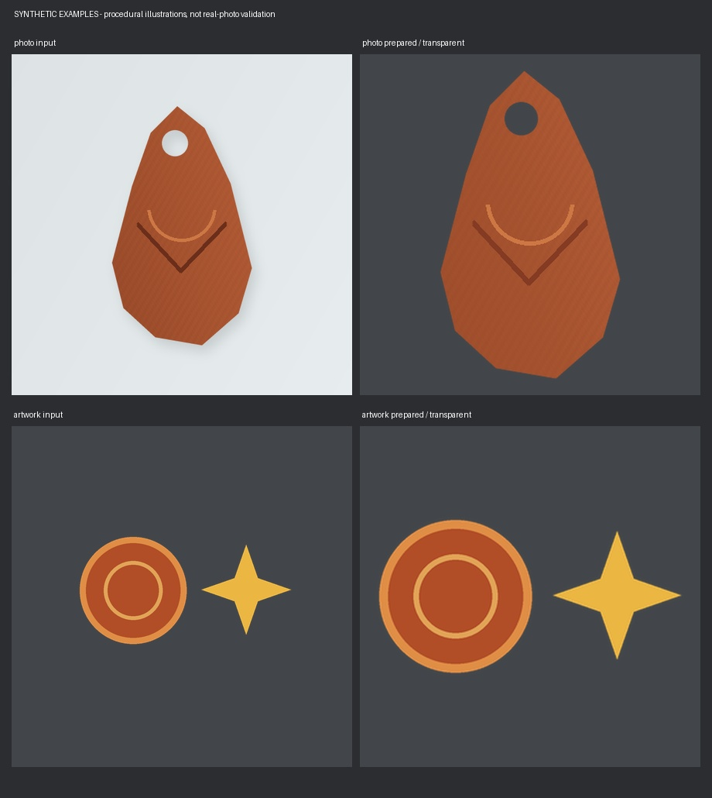

# Cutout Prep

[](https://github.com/gnomecannon/cutout-prep/actions/workflows/ci.yml)

Prepare isolated photographs and transparent artwork for game cutouts, decals,
cards, and icons. Cutout Prep combines automatic background extraction, color
preparation, alpha-aware resizing, padding, previews, and repeatable folder
processing. It runs locally on the CPU using traditional image processing and
per-image color calibration. Processing makes no network requests and downloads
no pretrained model weights.

**Experimental release.** Best suited to one connected, mostly opaque object on
a plain, contrasting background. Foliage photographs motivated the extraction
heuristics. Other subjects need representative trials and visual review.

## AI development disclosure

> AI generated all of this application's original code and tests. I am not a
> programmer. I provided the requirements, design direction, and hands-on review
> of image results, but I cannot independently audit the implementation. AI was
> also used for debugging, code review, documentation, and packaging. This project
> has not had an independent human code or security audit.

Read [the full disclosure](AI_DISCLOSURE.md) for the development history and the
distinction between AI-generated code and the local processing pipeline.

## Install

Requires **Python 3.10 or newer**. Use a separate virtual environment so the
image-processing dependencies do not replace packages used by other applications.
Download and extract the [source release](https://github.com/gnomecannon/cutout-prep/releases),
or clone this repository, then open a terminal in its folder.

Windows PowerShell:

```powershell
python -m venv .venv
.\.venv\Scripts\python -m pip install ".[raw]"
.\.venv\Scripts\cutout-prep --help
```

macOS/Linux shell:

```sh
python3 -m venv .venv
.venv/bin/python -m pip install ".[raw]"
.venv/bin/cutout-prep --help
```

The `raw` extra adds rawpy/LibRaw for DNG input. Use `pip install .` instead if
you only need ordinary image formats. Installation downloads dependencies;
subsequent processing works offline. Windows/Linux installation and tests run in
CI. macOS has not been separately validated for this release.

## Prepare photographs

On Windows, drag a folder onto **Process Images.cmd**, or double-click the
launcher and paste a folder path. It uses the adjacent `.venv`, an explicit
`CUTOUT_PREP_PYTHON` override, or an available Python launcher. It does not install
dependencies automatically. The command-line equivalent is:

```text
cutout-prep "path/to/photos"
```

The default `photo` preset automatically extracts the main subject, cleans edges,
and applies bounded exposure and shadow preparation. No hand-made masks or
per-photo seed points are required.

```text
Photos/
  object-a.jpg
  object-b.dng
  Processed/
    object-a_BaseColor.png
    object-b_BaseColor.png
    Preview.jpg
    ProcessingReport.json
```

Source files are never edited, renamed, or deleted. Default output is a 4096-square
8-bit sRGB PNG with straight alpha and 96-pixel minimum framing padding. The
subject keeps its proportions. Upscaling adds no captured detail.

## Prepare existing artwork

For transparent item renders or other already-authored color artwork:

```text
cutout-prep "path/to/artwork" --preset artwork --size 1024 --padding 24
```

The `artwork` preset keeps disconnected alpha components, retains opaque
backgrounds, and disables exposure, shadow lifting, saturation changes, and edge
decontamination. It still crops to the alpha bounds, resizes, centers, and pads.
Explicit settings can override preset values.

`--components all` preserves disconnected components of existing transparency.
Automatic background extraction still selects one main object; this switch does
not turn a photograph of several objects into a multi-object segmentation tool.

## Review and repeat

Inspect `Preview.jpg` and the report, especially thin stems, holes, fine branches,
color, and any captured or clipped tips. Automatic extraction always requests
visual review. Exit codes are:

| Code | Meaning |
| --- | --- |
| `0` | Batch completed without reported attention items |
| `1` | Batch setup failed |
| `2` | Per-file errors, changed inputs needing update, or visual review required |

Code `2` is expected after successfully preparing photographs that need review.
The report distinguishes `processed`, `unchanged`, `duplicate`, `excluded`,
`needs_update`, and `error`; an error can coexist with other successful files.

Unchanged, verified exports are skipped. Use `--update` for changed source/settings
when the previous managed export remains unmodified. Manually changed or
unrecognized exports are preserved; unrecognized or malformed reports are refused.
Recognized reports are tool-managed metadata and are rewritten, so keep manual
notes elsewhere. Missing inputs do not cause old
exports to be deleted. One writer holds each output directory's lock. See
[usage and settings](docs/USAGE.md) for recovery and advanced options.

Dependency versions, platform, processing code, and settings are recorded for
provenance and cache invalidation. Review results after upgrades; exact output
bytes across operating systems or dependency versions are not guaranteed.

## What it can and cannot prepare

- **Good candidates:** single leaves, flowers or seed pods, isolated plant debris,
  bark chips, stones and small objects on contrasting plain backgrounds, plus
  already-transparent color artwork. Foliage is the main real-photograph
  validation history; other categories are candidates rather than guarantees.
- **Fine detail needs review:** dense needles, fur, glass, translucency, reflective
  surfaces, low contrast and busy scenes can leave background or lose detail.
  Connected thin-feature and interior-hole protection are estimates.
- **Color artwork only:** normal maps, roughness, metallic, height and packed masks
  must use a data-texture workflow. This pipeline converts colors to sRGB and
  exports RGBA8; it is not a high-bit-depth master or HDR workflow.
- **Framing is intentional:** seamless textures, atlases, sprite sheets and
  photogrammetry source photographs require different handling. Even
  `--background keep` retains the square crop/resize/padding behavior.
- **Prepared color is approximate:** one photograph cannot establish measured
  albedo or physical roughness. DNG calibration uses supported camera metadata
  and matched preview color statistics, never preview texture pixels. Uncertain
  shadow colors can remain neutral or inaccurate. Missing/clipped detail is not
  reconstructed, and there is no generated sharpening or species identification.
- **Pair alignment is advanced:** the Python API can mirror and globally position
  two prepared silhouettes. Natural curl and shape differences remain. It does
  not create matching contours, meshes, or game-engine materials.

## Examples



This demonstration is **procedurally generated synthetic artwork**, not a camera
photograph or proof of photographic extraction quality. It makes the framing,
alpha, and component-retention behavior reproducible without distributing private
project images. See [examples](examples/README.md).

## Development

```text
python -m pip install ".[dev,raw]"
python -m unittest discover -s tests -v
python -m build
```

The tests cover specific processing and file-safety contracts, not universal
photo quality or expert human acceptance. See [contributing](CONTRIBUTING.md),
[security and local-file boundaries](SECURITY.md), and [the changelog](CHANGELOG.md).

The application is MIT licensed. Dependencies retain their own licenses; see
[third-party notices](THIRD_PARTY_NOTICES.md).
