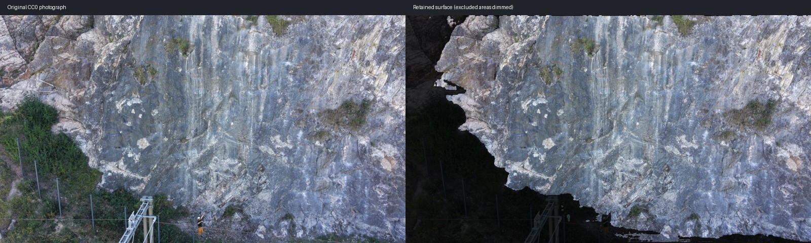

# Validation of the experimental desktop release

Checks establish specific behaviors, not a general mask-accuracy score.

Rounded dependency probes and successful UI tests do not establish real cutout
quality. The [real-photo review protocol](REAL_PHOTO_TESTS.md) provides a pinned
online case group, source/license records and a repeatable before/after review.

## Automated and packaged checks

- Version 0.4.2 passed 88 source regressions on native Windows and Apple Silicon
  macOS (one Windows symlink-privilege skip). New contracts cover fractional
  color/alpha recomposition, paper contact shadows, unchanged near-opaque and
  colored material, enclosed pale tissue and avoiding noise amplification.
- Version 0.4.1 passed the expanded 83-test source suite on native Windows and
  Apple Silicon macOS (one Windows symlink-privilege skip). Added contracts cover
  rejected-paper regrowth, retained colored branches/pale details and keeping
  solid rock glints or pale subjects out of the conditional crop pass. Real fern
  and held-out conifer comparisons are recorded in [REAL_PHOTO_TESTS.md](REAL_PHOTO_TESTS.md).
- Version 0.4 passed 78 regression tests on native Windows and Apple Silicon
  macOS, with one Windows symlink-privilege skip. The added cases protect bright
  opaque glints, real holes, narrow stems, disconnected subjects and supplied
  alpha. Windows/macOS/Linux CI also passed. Native Tk exercises verified saved
  detailed-method and separate-piece choices, edited rotations/pairs, changed
  outputs and reopened choices. Picker return values were supplied.
- Both 0.4 portable builds passed inference with their bundled detailed-cutout
  model as well as the existing scan/tracking runtime and leaf pair/holes checks.
  Readable and compiled application content passed the private-identifier audit.
  These are packaging/workflow checks; real-image limitations are documented in
  [the 2D pipeline](2D_MASKING.md) and [the photo comparisons](REAL_PHOTO_TESTS.md).
- Both 0.4 portable apps processed the pinned 18-image corpus at 1536 pixels,
  preserving source hashes. This includes 15 opaque captures and three
  supplied-alpha preservation controls. A separate five-photo private leaf
  trial at 4096 pixels preserved the originals, aligned the matching RAW pair
  and kept the incompatible pair independent. The fine sprig still has small
  residual backing/specks; these trials are not universal acceptance.
- At the v0.3.0 release, 66 regression tests passed locally, covering the existing image processor,
  original-byte preservation, EXIF mask orientation, full-size exports, protected
  manual changes, project locks, review/tracking behavior and fresh default result
  folders that preserve earlier work. One Windows symlink
  privilege check was skipped. macOS also passed the source regression suite.
- Native Windows x64 and Apple Silicon packages passed real local image-model
  and temporal-tracking inference from their bundled model.
- A native Tk workflow exercise passed on Windows and macOS: box/point selection,
  undo, preview, save/reopen, persisted edge settings, cancellation, batch export,
  and three leaf/image cutouts. That harness supplies file-picker return values;
  it does **not** establish human OS-picker acceptance. The compiled Windows
  layout and native photo-picker opening were separately observed.
- The simplified workflow checks one folder-picker call, helpful handling of a
  missing starting selection, automatic saving from Process photos, automatic
  saving after acceptance, one-picker leaf cutouts, and primary controls fitting
  the minimum window size. Windows main-screen, menu and leaf layouts were also
  observed through the native app. Human native-picker selection remains unverified.
- Leaf checks cover protected regeneration, color/real-hole parity, explicit-name
  pairing, rejection of incompatible outlines, clear-stem quarter-turns, saved
  recipe authority and skipped views. The native workflow also edits orientation,
  assigns an unlabeled pair, processes again, verifies changed pixels and reopens
  the saved choices. Portable checks exercise the bundled leaf-pair fitting
  code with procedural silhouettes; this is not real-photo quality evidence.
- The desktop artwork route matches the established artwork preset, including
  translucent color and disconnected supplied alpha pieces. A missing per-photo
  mask is reported without blocking unrelated valid photographs.
- Original photo hashes and exported source pixel dimensions were checked.
  An automatic Ready label does not establish a pixel-perfect silhouette.

## Real photo-group trials

These scan trials were recorded for 0.2.1. Later interfaces keep the same underlying
segmentation and tracking algorithms; these are not new mask-accuracy trials.

## Leaf preparation trials

At version 0.3, the leaf background, hole-protection, shadow and color modules were compared with
the established preparation tool; those algorithms were already shared. This
release added orchestration and native correction controls, rather than claiming
a new background-removal or lighting algorithm.

Five private photographs were tested at 4096 output pixels: three high-resolution
RAW views and two incompatible front/rear photographs. A RAW pair's mirrored
whole-outline overlap improved from 0.819 to 0.941; an incompatible pair at 0.717
was kept independent and flagged. A multi-tip sprig had ambiguous stem direction
and retained its photographed orientation. A separate real RAW trial honored its
saved quarter-turn recipe through the one-pass route. All source hashes remained
unchanged. Existing asset-library exports and recipes were read-only.

The five-photo geometry trial took about six minutes on the local CPU and all
five extractions retained their existing background-review flags. The separate
one-pass RAW trial took about 52 seconds. These are small case studies, not a
general accuracy or performance benchmark. The earlier prepared and newly
prepared front were visually compared; natural rear-outline differences remain.
No private leaf photographs, recipes, filenames or trial output are published.

An exploratory mask-only transfer of the leaf cleaner to three light-box rock
views preserved original photo hashes, metadata framing and mask dimensions,
but retained parts of the enclosure even with a focused analysis region. That
candidate failed visual isolation and is not included. The normal 3D-scan
subject-selection workflow remains in use.

| Group | Photos | Automatic outcome | Observed limitation |
| --- | ---: | --- | --- |
| Controlled turntable rock | 56 | 56 ready/exported, two initial selections | Capture coverage, contact/support edges and real material appearance still need inspection |
| Korno cliff subset | 7 | 7 ready/exported with expected-edge setting enabled | Some peripheral rock is omitted; wires crossing the face and small surface vegetation remain |
| Turntable skull subset | 46 | 9 ready/exported, 37 held for review | The later selections themselves reach the image border; those warnings remain intentionally active |

The cliff masks did not become more accurate when their framing warning was
removed. The setting records an expected capture condition. Identity uncertainty
continues to hold following frames until a new selection or approval.

Earlier trials also exercised an outdoor statue and a difficult bicycle scene.
The bicycle retained overlapping bench/background pixels even with a high model
score and lost tracking as the target became cropped, occluded or absent. It is
not an example of a supported unattended workflow.

## Reconstruction integration

RealityScan 2.2 imported all 56 exported rock mask layers, aligned the photos into
two components, and exported a CPU sparse-preview mesh from the selected largest
component: 24,500 vertices / 48,996 faces. This verifies a mask-import/alignment/
preview-mesh path. It does not verify a dense, complete, textured reconstruction,
the unseen underside, elimination of every support artifact, or physical material
properties. No private rock photographs or reconstruction project are published.

## Public example

The source photograph is Zbytovsky's
[Korno climbing rock view 01](https://commons.wikimedia.org/wiki/File:Photogrammetry_dataset_of_Korno_climbing_rock_01.jpg),
published under CC0. The repository includes a resized, EXIF-free photograph and
the generated binary mask. The comparison dims excluded pixels; it is not a new
photograph or independently drawn ground-truth mask. The mask's imperfect edges
remain visible. The complete public dataset is linked from the source page.
